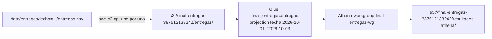

# Punto 1 (3.0) – Entregas: S3 + Glue Data Catalog (partition projection) + Athena

Solución del repositorio [smm-0216/DE-Final-Entregas](https://github.com/smm-0216/DE-Final-Entregas). El enunciado
original está en [`ENUNCIADO.md`](ENUNCIADO.md).

Una empresa de mensajería recibe un CSV diario con los intentos de entrega. Los archivos se guardan en S3. Glue
Data Catalog describe una tabla externa con **partition projection** sobre `fecha`, y Athena la consulta sin
crawlers ni registro de particiones. Los resultados de Athena se escriben en otro prefijo del mismo bucket.



## Estructura

```text
punto1-entregas-aws/
├── README.md · respuestas.md · .gitignore · .gitattributes · ENUNCIADO.md
├── infraestructura/   principal.tf · variables.tf · salidas.tf
├── consultas/         intentos_por_fecha_estado.sql · porcentaje_exito_por_fecha_ciudad.sql
│                      duracion_promedio_2026-10-02.sql · verificacion_tercer_dia.sql · conteo_total.sql (extra)
├── resultados/        inicial/*.csv · final/*.csv            (obtenidos en Athena)
├── resultados_esperados/                                    (referencias del enunciado, sin cambios)
├── data/entregas/fecha=2026-10-0{1,2,3}/entregas.csv        (datos del enunciado, sin cambios)
├── scripts/           cargar_dia.sh · athena.sh · comparar.sh
└── evidencias/        aplicacion_terraform.txt · outputs.json · ejecuciones_athena.csv · eliminacion_terraform.txt
                       + plan, cargas, comparaciones y capturas de la consola (capturas/)
```

## Prerrequisitos

| Herramienta | Versión usada |
|---|---|
| Terraform | 1.17.0 (proveedor `hashicorp/aws ~> 6.0`) |
| AWS CLI | 2.34 |
| Bash | WSL2 Ubuntu 24.04 (los scripts usan `bash`, `sha256sum`, `diff`) |

- Cuenta `387512138242`, región **`us-east-1`**, usuario IAM `sebastian-admin` (`AdministratorAccess`). Se
  configura con `aws configure` (credenciales en `~/.aws/`, **fuera** del repositorio). Evidencia en
  [`evidencias/acceso/`](evidencias/acceso/).
- El estado de Terraform es local (`infraestructura/terraform.tfstate`) y está excluido por `.gitignore`, igual
  que `.terraform/` y cualquier credencial.

## Configuración

Las variables tienen valores por defecto (`infraestructura/variables.tf`), así que no hace falta un `.tfvars`:

| Variable | Valor | Uso |
|---|---|---|
| `region` | `us-east-1` | Región del despliegue |
| `prefijo` | `final-entregas` | Bucket `final-entregas-<id cuenta>` y workgroup `final-entregas-wg` |
| `nombre_base_datos` / `nombre_tabla` | `final_entregas` / `entregas` | Catálogo de Glue |
| `prefijo_datos` / `prefijo_resultados` | `entregas/` / `resultados-athena/` | Prefijos del bucket |
| `rango_fechas` | `["2026-10-01", "2026-10-03"]` | Rango de la proyección (incluido) |
| `limite_bytes_por_consulta` | 10 MB | Control de costos del workgroup |

## Recursos creados con Terraform (`infraestructura/principal.tf`)

1. **Bucket S3 privado** `final-entregas-387512138242`: bloqueo de acceso público completo, `BucketOwnerEnforced`,
   cifrado SSE-S3 y `force_destroy` para poder eliminarlo con datos.
2. **Prefijos separados:** `entregas/` (datos) y `resultados-athena/` (Athena). No requieren objetos previos;
   la tabla y el workgroup apuntan a cada uno.
3. **Base de datos Glue** `final_entregas`.
4. **Tabla externa** `final_entregas.entregas`:
   - columnas `id_envio string, ciudad string, transportadora string, estado string, duracion_minutos int`,
     en el orden del archivo;
   - `LazySimpleSerDe` con `field.delim=","` y `skip.header.line.count=1`;
   - clave de partición `fecha string`, separada de las columnas;
   - `projection.enabled=true`, `projection.fecha.type=date`, `projection.fecha.format=yyyy-MM-dd`,
     `projection.fecha.range=2026-10-01,2026-10-03`, `projection.fecha.interval=1`, `projection.fecha.interval.unit=DAYS`;
   - `storage.location.template=s3://final-entregas-387512138242/entregas/fecha=${fecha}/` (prefijo terminado en `/`).
   - **No** se crean particiones individuales.
5. **Workgroup Athena** `final-entregas-wg`: resultados en `s3://…/resultados-athena/` (SSE-S3), configuración
   forzada para los clientes y límite de 10 MB escaneados por consulta.
6. **Outputs** (`infraestructura/salidas.tf`): `bucket`, `base_datos`, `tabla`, `tabla_completa`, `workgroup`,
   `ubicacion_datos`, `ubicacion_resultados_athena` y `region`.

## Pasos realizados

Todos los comandos se ejecutan desde `punto1-entregas-aws/`.

### 1. Despliegue

```bash
cd infraestructura
terraform init
terraform plan -out=tfplan              # 7 to add  -> evidencias/plan_terraform.txt
terraform apply tfplan                  #           -> evidencias/aplicacion_terraform.txt
terraform output -json > ../evidencias/outputs.json
cd ..
```

### 2. Etapa inicial: solo días 1 y 2

Cada archivo se sube **individualmente**, sin carga recursiva (`scripts/cargar_dia.sh` es un solo `aws s3 cp`):

```bash
bash scripts/cargar_dia.sh 2026-10-01   # -> s3://final-entregas-387512138242/entregas/fecha=2026-10-01/entregas.csv
bash scripts/cargar_dia.sh 2026-10-02   # -> s3://final-entregas-387512138242/entregas/fecha=2026-10-02/entregas.csv
```

`evidencias/carga_inicial_s3.txt` muestra la carga, el listado del prefijo (solo 2 objetos) y que el sha256 de
cada objeto en S3 es **idéntico** al archivo original.

Consultas (cada una se ejecuta en el workgroup, se descarga el CSV y se registra en `evidencias/ejecuciones_athena.csv`):

```bash
bash scripts/athena.sh inicial consultas/intentos_por_fecha_estado.sql         resultados/inicial/intentos_por_fecha_estado.csv
bash scripts/athena.sh inicial consultas/porcentaje_exito_por_fecha_ciudad.sql resultados/inicial/porcentaje_exito_por_fecha_ciudad.csv
bash scripts/athena.sh inicial consultas/duracion_promedio_2026-10-02.sql      resultados/inicial/duracion_promedio_2026-10-02.csv
bash scripts/athena.sh inicial consultas/conteo_total.sql                      resultados/inicial/conteo_total.csv
bash scripts/comparar.sh inicial        # -> evidencias/comparacion_inicial.txt
```

Resultado: **12 registros** (6 + 6). Los tres resultados son **IGUALES** a las referencias `*_inicial.csv` y
`duracion_promedio_2026-10-02.csv` (36.67 min).

### 3. Etapa final: nueva fecha (día 3)

Sin tocar la infraestructura (`terraform plan` = *no changes*) ni la tabla, solo se sube el tercer archivo y se consulta:

```bash
bash scripts/cargar_dia.sh 2026-10-03
bash scripts/athena.sh final consultas/verificacion_tercer_dia.sql resultados/final/verificacion_tercer_dia.csv   1
bash scripts/athena.sh final consultas/verificacion_tercer_dia.sql resultados/final/conteos_estado_tercer_dia.csv 2
bash scripts/athena.sh final consultas/verificacion_tercer_dia.sql resultados/final/total_registros_tabla.csv     3
bash scripts/athena.sh final consultas/intentos_por_fecha_estado.sql         resultados/final/intentos_por_fecha_estado.csv
bash scripts/athena.sh final consultas/porcentaje_exito_por_fecha_ciudad.sql resultados/final/porcentaje_exito_por_fecha_ciudad.csv
bash scripts/athena.sh final consultas/conteo_total.sql                      resultados/final/conteo_total.csv
bash scripts/comparar.sh final          # -> evidencias/comparacion_final.txt
```

No se usaron crawlers, `MSCK REPAIR TABLE` ni `ALTER TABLE ADD PARTITION`. Glue sigue con **0 particiones**
registradas (`evidencias/carga_final_s3.txt`).

Resultado:
- Los **6 registros** del 2026-10-03 aparecen (ENV-013 a ENV-018).
- Conteos por estado del día 3: `destinatario_ausente` 3, `direccion_incorrecta` 1, `entregado` 2.
- **18 registros** en total, en 3 fechas.
- Intentos y porcentaje de éxito son **IGUALES** a las referencias `*_final.csv`.

Las consultas de intentos y porcentaje no tienen filtro de fechas, así que el mismo SQL de la etapa inicial
cubre los tres días.

### 4. Limpieza

Antes de eliminar se guardaron todas las evidencias. `force_destroy` en el bucket y en el workgroup permite que
Terraform elimine también los CSV y los resultados de Athena:

```bash
cd infraestructura
terraform destroy                       # -> evidencias/eliminacion_terraform.txt
aws s3 ls | grep final-entregas         # sin resultados
aws glue get-database --name final_entregas            # EntityNotFoundException
aws athena get-work-group --work-group final-entregas-wg  # InvalidRequestException
```

## Consultas (`consultas/`)

| Archivo | Qué hace | Detalle |
|---|---|---|
| `intentos_por_fecha_estado.sql` | `COUNT(*)` por `fecha, estado` | `ORDER BY fecha, estado` |
| `porcentaje_exito_por_fecha_ciudad.sql` | `100 × entregados / total` por `fecha, ciudad` | División en `DOUBLE` (sin división entera). El denominador cuenta los tres estados. `ROUND(…,2)` como `DECIMAL(5,2)` para mantener 2 decimales |
| `duracion_promedio_2026-10-02.sql` | `AVG(duracion_minutos)` | Solo `estado = 'entregado'` y `fecha = '2026-10-02'`. Los ceros de los fallidos no entran |
| `verificacion_tercer_dia.sql` | 3 sentencias | Registros del día 3, conteos por estado del día 3, total de la tabla y desglose por fecha |
| `conteo_total.sql` (extra) | Registros por fecha y total | Muestra 12 en la etapa inicial y 18 en la final |

## Evidencias

| Evidencia | Archivo |
|---|---|
| Acceso (usuario IAM e identidad CLI) | [`evidencias/acceso/`](evidencias/acceso/) |
| Plan, aplicación y outputs de Terraform | [`plan_terraform.txt`](evidencias/plan_terraform.txt), [`aplicacion_terraform.txt`](evidencias/aplicacion_terraform.txt), [`outputs.json`](evidencias/outputs.json) |
| Recursos en la consola (tabla, esquema, propiedades de proyección, sin particiones, bucket privado, workgroup) | [`capturas/01-infraestructura/`](evidencias/capturas/01-infraestructura/) |
| Carga inicial y verificación sha256 | [`carga_inicial_s3.txt`](evidencias/carga_inicial_s3.txt), [`capturas/02-etapa-inicial/`](evidencias/capturas/02-etapa-inicial/) |
| Carga del día 3, plan sin cambios y 0 particiones | [`carga_final_s3.txt`](evidencias/carga_final_s3.txt), [`capturas/03-etapa-final/`](evidencias/capturas/03-etapa-final/) |
| Ejecuciones de Athena (etapa, SQL, ID, resultado) | [`ejecuciones_athena.csv`](evidencias/ejecuciones_athena.csv) |
| Comparación con las referencias | [`comparacion_inicial.txt`](evidencias/comparacion_inicial.txt), [`comparacion_final.txt`](evidencias/comparacion_final.txt) |
| Eliminación con Terraform (`7 destroyed`) y verificación (bucket 404, base/tabla/workgroup inexistentes) | [`eliminacion_terraform.txt`](evidencias/eliminacion_terraform.txt), [`capturas/04-eliminacion/`](evidencias/capturas/04-eliminacion/) |
| Respuestas | [`respuestas.md`](respuestas.md) |

### Notas

- **Formato de los resultados.** Athena escribe su CSV con comillas dobles y fin de línea CRLF. Como ningún valor
  tiene comas, `scripts/athena.sh` quita las comillas y los `\r`, y deja el mismo formato que
  `resultados_esperados/` (UTF-8, LF). Así se pueden comparar con `diff`.
- **Finales de línea de los datos.** Al principio, las copias locales de los CSV tenían CRLF porque git las
  convirtió al clonar desde Windows (`core.autocrlf`). Se detectó al comparar, se restauraron los originales en
  LF desde un clon de Linux y se volvieron a subir los días 1 y 2 antes de registrar las ejecuciones. El
  `.gitattributes` fija `eol=lf` para que no vuelva a pasar. Por eso el historial del workgroup tiene algunas
  ejecuciones de ese primer intento que no aparecen en `ejecuciones_athena.csv`.
- **Costo.** S3 guarda unos KB. Cada consulta de Athena escanea menos de 1 KB y se cobra el mínimo de 10 MB,
  así que el total queda en centavos. Todo se elimina al terminar.
